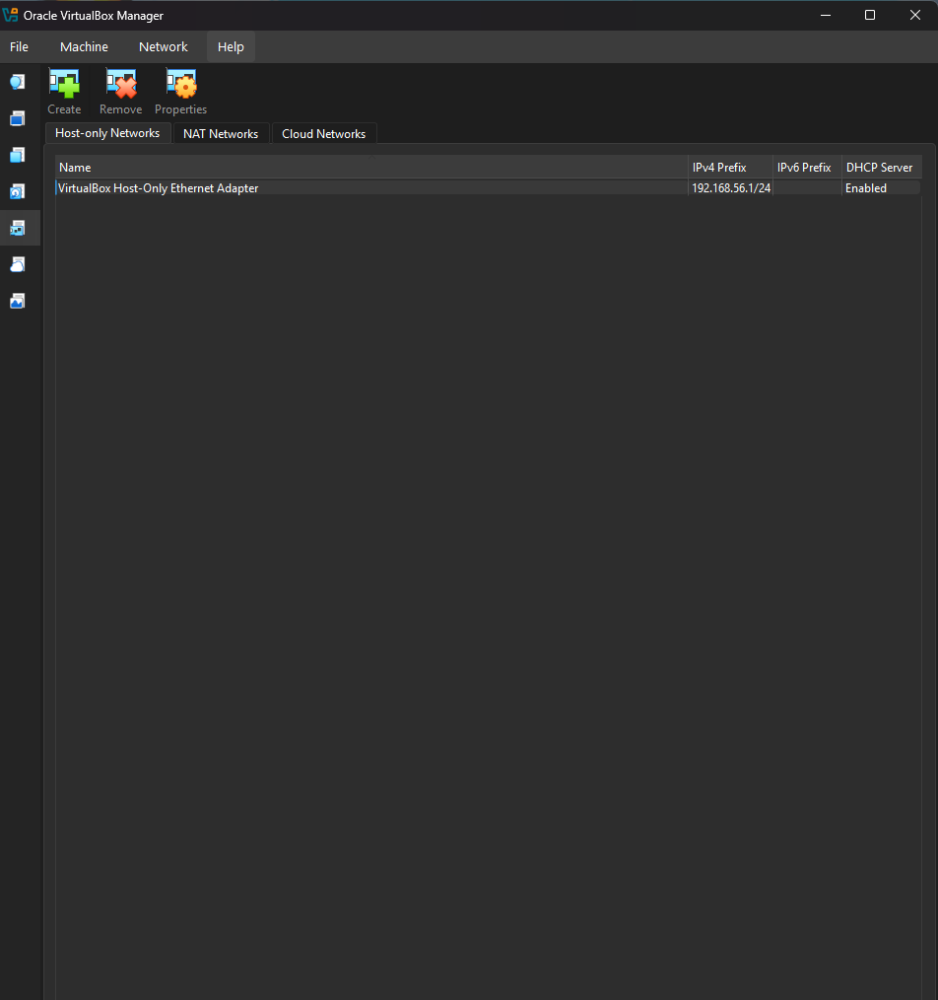
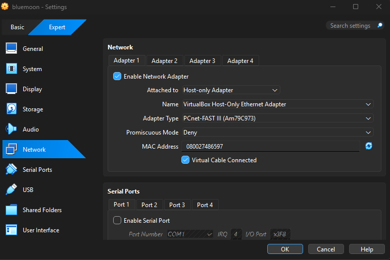
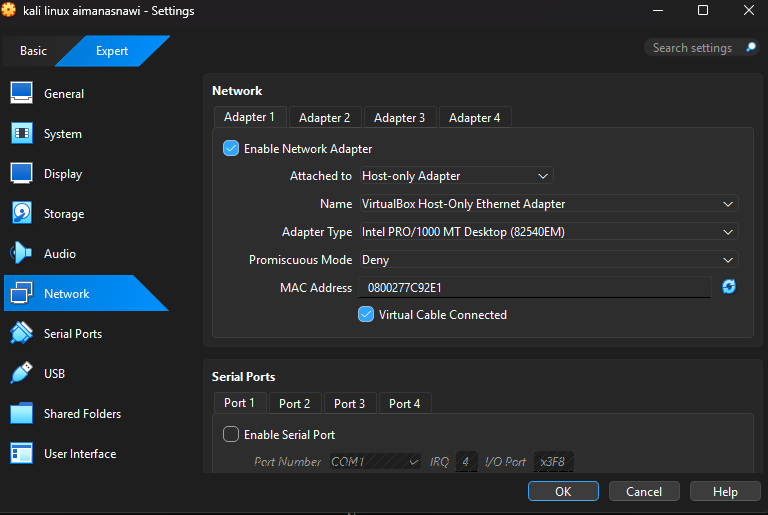
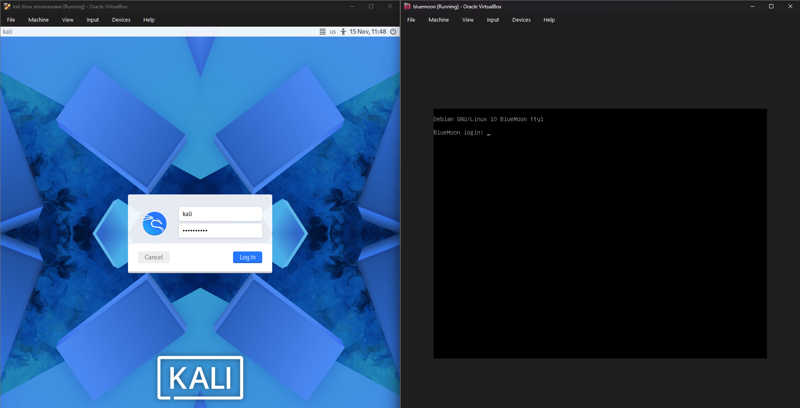
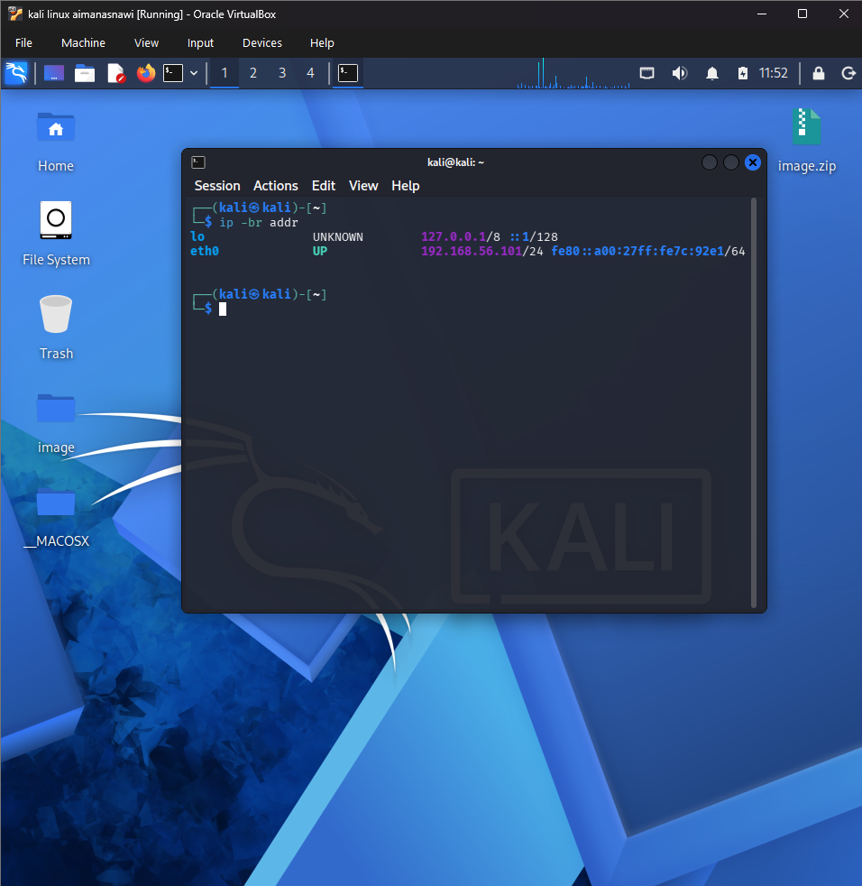
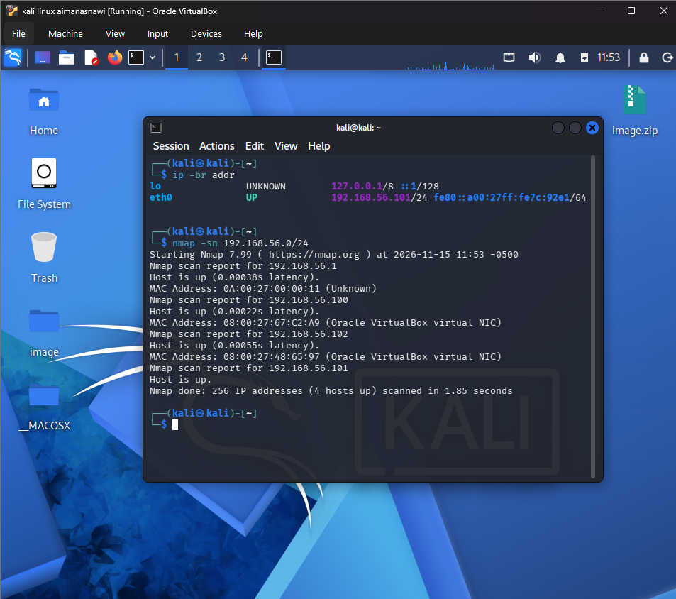
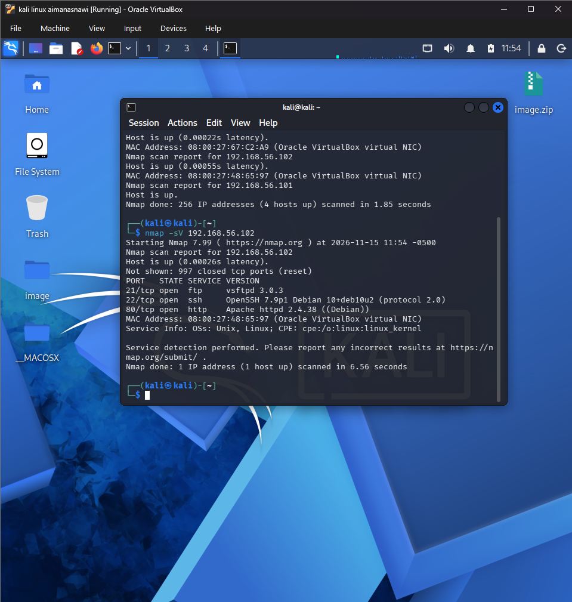
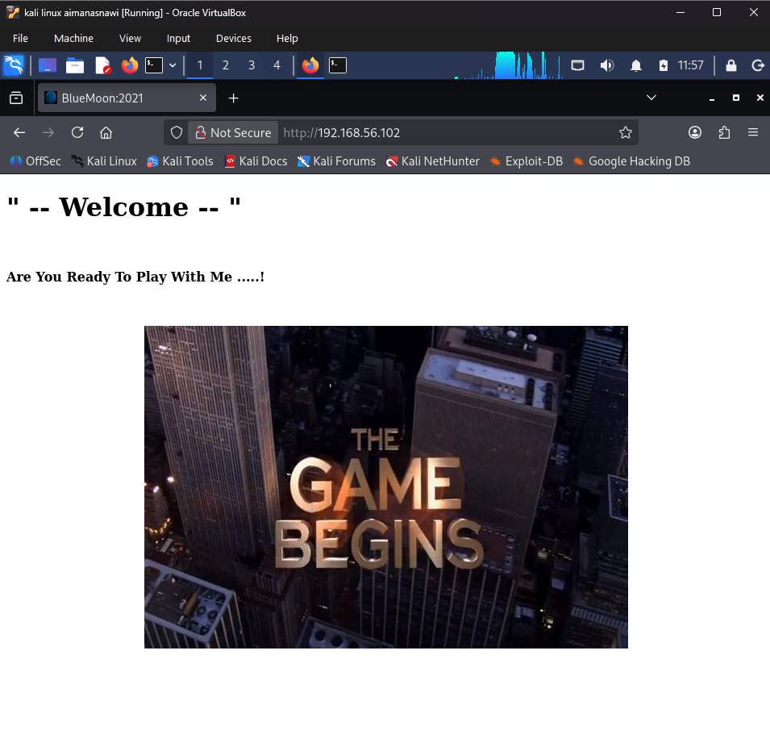

# Lab 4 — Active Footprinting (Vulnerable Machine)

**Name:** Muhammad Aiman Asnawi bin Azman
**Class:** L01-B03
**Target:** BlueMoon:2021 (VulnHub vulnerable machine)
**Scope:** Active reconnaissance only, inside an isolated VirtualBox lab network (`192.168.56.0/24`). No exploitation, no brute-force, no public-domain scanning.

---

## Part 1: Lab Setup

**Attacker VM:** Kali Linux
**Target VM:** BlueMoon:2021 (Debian GNU/Linux 10)
**Adapter mode:** Host-Only Adapter (VirtualBox)
**Assigned network (CIDR):** 192.168.56.0/24

Both VMs were configured to use the same VirtualBox **Host-Only Adapter**, so they sit in the same isolated lab network and can reach each other without touching the real internet or any public host.






---

## Part 2: Own Host & Discovered Hosts

**Tool/method:** `ip -br addr`, `nmap -sn`
**Capture timestamp:** 16 Nov 2026, ~11:52–11:53 MYT

**Own host (attacker):**
```
$ ip -br addr
lo       UNKNOWN   127.0.0.1/8 ::1/128
eth0     UP        192.168.56.101/24 fe80::a00:27ff:fe7c:92e1/64
```
Kali's own IP on the lab network is **192.168.56.101**.



**Host discovery:**
```
$ nmap -sn 192.168.56.0/24
Nmap scan report for 192.168.56.1   — Host is up (host machine)
Nmap scan report for 192.168.56.100 — Host is up (VirtualBox DHCP server)
Nmap scan report for 192.168.56.102 — Host is up (Oracle VirtualBox virtual NIC)
Nmap scan report for 192.168.56.101 — Host is up (this is Kali itself)
Nmap done: 256 IP addresses (4 hosts up) scanned in 1.85 seconds
```
4 hosts were found alive on the lab segment. **192.168.56.102** was the candidate target host (an Oracle VirtualBox virtual NIC that is not the host machine, the DHCP service, or Kali itself).



---

## Part 3: Services & Interpretation

**Tool/method:** `nmap -sV`, browser verification
**Capture timestamp:** 16 Nov 2026, ~11:54–11:57 MYT

```
$ nmap -sV 192.168.56.102
PORT   STATE SERVICE VERSION
21/tcp open  ftp     vsftpd 3.0.3
22/tcp open  ssh     OpenSSH 7.9p1 Debian 10+deb10u2 (protocol 2.0)
80/tcp open  http    Apache httpd 2.4.38 ((Debian))
Service Info: OSs: Unix, Linux; CPE: cpe:/o:linux:linux_kernel
```

**Observation:** 192.168.56.102 is running Debian 10, with FTP (vsftpd), SSH (OpenSSH) and a web server (Apache) exposed.

**Interpretation:**
- **Establishes:** the host is running three services — an FTP server, an SSH server, and a web server — and the underlying OS fingerprint (Debian 10) matches BlueMoon's known OS.
- **Suggests:** the host is set up as a web-facing training target, consistent with the "attack only web" scope of this lab (port 80 open).
- **Does not prove:** by itself, that any of these services is actually vulnerable — an open port only shows the service is reachable, not that it is exploitable.

**Confirmation via browser:** visiting `http://192.168.56.102` in Firefox returned a page titled **"BlueMoon:2021"**, matching the login banner seen on the VM console ("Debian GNU/Linux 10 BlueMoon") and confirming the target's identity.




---

## Part 4: Limitations / Risks

- **False negatives:** Nmap only reports services it could actively detect at scan time. A firewall, rate-limiting, or filtering on the target could hide additional open ports that this scan did not reveal — the 3 ports found (21, 22, 80) are not guaranteed to be the only services running.
- **Open port ≠ vulnerability:** finding a port open (e.g. port 80) only confirms the service is reachable and responding. It does not by itself prove the service is misconfigured or exploitable — further analysis (e.g. checking the specific software version against known vulnerabilities) would be needed to draw that conclusion.
- **Point-in-time snapshot:** this scan reflects the state of the target at the exact moment it was run (16 Nov 2026, ~11:54 MYT). Services can be started, stopped, or reconfigured at any other time, so the result is not a permanent guarantee of the target's state.
- **Assumption:** 192.168.56.102 was identified as the target by elimination (it was not the host machine, the DHCP server, or Kali itself) and then confirmed via OS fingerprint and the web page title — not via any prior/official labeling by VirtualBox.

---

*This investigation was carried out entirely inside an isolated VirtualBox host-only lab network against a VM the student owns and controls (BlueMoon:2021, from VulnHub). No public-domain host was scanned, and no exploitation, brute-force, persistence, or destructive testing was performed.*
